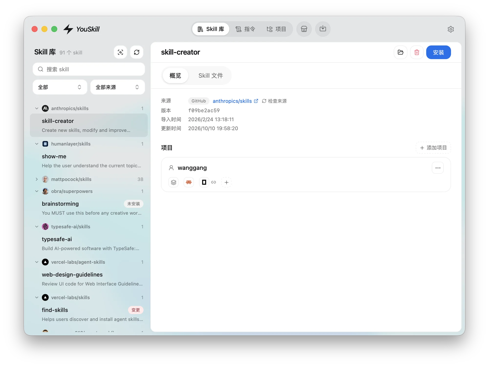
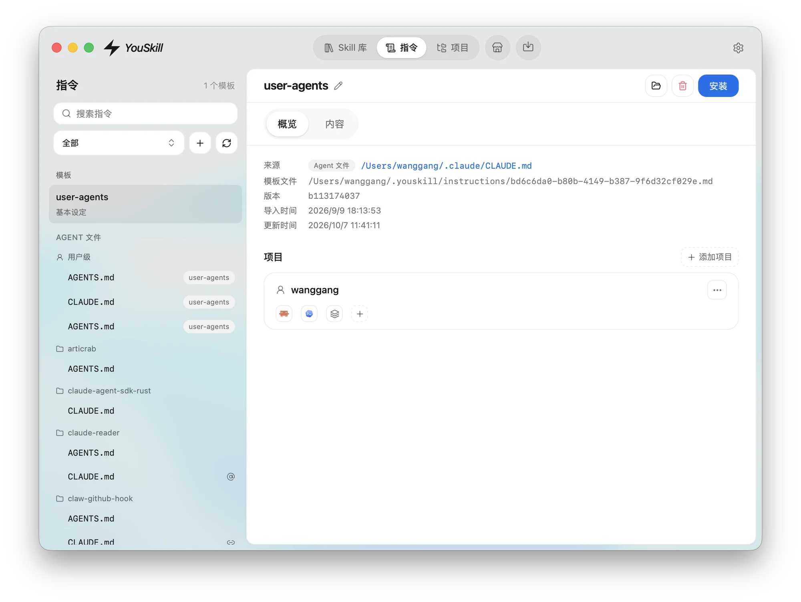
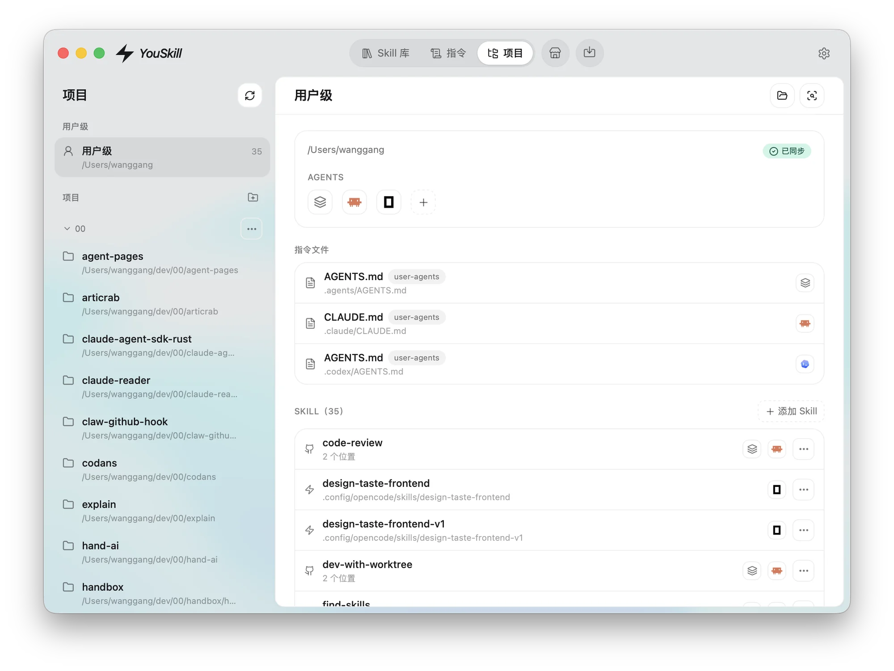

# YouSkill

[](https://github.com/wanggang316/you-skill/releases)
[](https://github.com/wanggang316/you-skill/releases)
[](https://tauri.app/)

English | [中文](README_ZH.md)

**Your partner for managing Agent assets.**

YouSkill is a lightweight desktop app for managing [Agent Skills](https://agentskills.io/) and instruction files across your Agents and projects. Keep them in one central library, track changes at each install location, and choose which version to keep. Built with Tauri for a fast, lightweight experience.

## Manage the Entire Skill Lifecycle

1. **Import once.** Browse the built-in marketplace, paste a GitHub URL, or choose a `.zip` / `.skill` archive or local folder.
2. **Install where you need it.** Choose user level or a project, select your Agents, and install by copy or symlink. Use built-in Agents such as Claude Code, Codex, Cursor, and OpenCode, or add a custom Agent by its Skill directory.
3. **Track every copy.** See which Skills are installed in each project and Agent. Identify outdated copies, local edits, and conflicts before you sync.
4. **Choose what to update.** Check the source for updates, view local differences, then adopt a local copy into the library or push the library version to your targets.

## Features

- **One central library.** Organize Skills by source, inspect their files, and see their versions and install locations. Scan existing Agent or project folders to bring Skills into the library.
- **Shared instructions.** Manage `AGENTS.md` and `CLAUDE.md` templates in one place and apply them across Agents and projects.
- **Translation and bilingual reading.** Use LLM translation to read Skills in your preferred language alongside the original text.
- **Built-in marketplace.** Browse Skills by category, import them with one click, and see which ones are already in your library.
- **Terminal workflow.** Use the `youskill` CLI to import, install, inspect, and sync Skills and instructions, including from your Agent.
- **Everyday essentials.** Back up your library and choose a theme or interface language.

See [docs/ARCHITECTURE.md](docs/ARCHITECTURE.md) for the storage layout and change tracking model,
and [docs/CLI.md](docs/CLI.md) for the command line interface.

## Preview

### Skill Library

Browse Skills by source and inspect their versions, files, and install locations.



### Instructions

Manage reusable instruction templates and see the Agents and projects that use them.



### Projects

See each project's Agents, instruction files, and installed Skills in one place.



## Download

### Homebrew (macOS)

```bash
# App
brew install --cask wanggang316/tap/youskill

# Command line tool only
brew install wanggang316/tap/youskill
```

The app updates itself. It can also link its bundled `youskill` command line tool from
Settings > "Command line tool", so you do not need the formula when you use the app.

### Installers

Download installers from [Releases](https://github.com/wanggang316/you-skill/releases):

- **macOS**: `YouSkill_x.x.x_aarch64.dmg` (Apple Silicon) / `YouSkill_x.x.x_x64.dmg` (Intel)
- **Windows**: `YouSkill_x.x.x_x64-setup.exe`

## Tech Stack

- **Tauri v2**
- **Svelte 5**
- **Vite**
- **Tailwind CSS**
- **Lucide Icons**

## Project Structure

- `src/`: Frontend core
- `src-tauri/`: Rust backend and packaging config
- `scripts/`: Release and maintenance scripts

## Development

### Prerequisites

- [Node.js](https://nodejs.org/) (recommended: 18+)
- [Rust](https://www.rust-lang.org/tools/install)
- [Tauri prerequisites](https://tauri.app/start/prerequisites/)

### Install dependencies

```bash
npm install
```

### Run locally

```bash
npm run tauri -- dev
```

### Build

```bash
npm run build
npm run tauri -- build
```

### Release

1. Edit the `[Unreleased]` section in [CHANGELOG.md](CHANGELOG.md) with the changes for this release
2. Run the release script:
   ```bash
   npm run release <version>
   ```
   Example: `npm run release 0.9.0`

### Development Rules

[AGENTS.md](AGENTS.md)

## Roadmap

- [x] Project-Level skill management
- [x] Central skill library with change tracking and folder scanning
- [x] Skill details with support for viewing all skill files
- [ ] Backup to GitHub for Multi-Device sync
- [ ] AI-Powered find skill

## Contributing

[CONTRIBUTING.md](CONTRIBUTING.md)

## License

MIT
